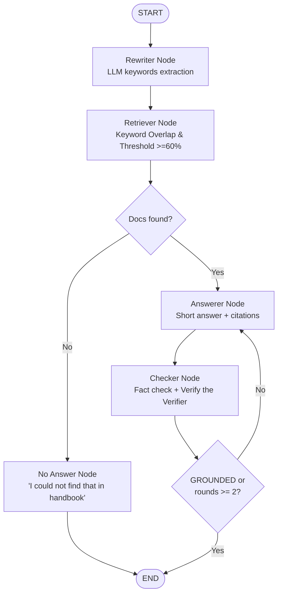

# RAG Team Agent — Multi-Agent Handbook Assistant

A multi-agent RAG (Retrieval-Augmented Generation) CLI application built in Python using **LangChain**, **LangGraph**, and local **Ollama (`llama3.2`)**.

The agent rewrites user questions into search keywords, retrieves company handbook passages without an LLM (using keyword overlap scoring with a 60% threshold), generates answers strictly from context passages with citations, and verifies every fact in an evaluation loop.

---

## Architecture & Workflow



### Team Roles

1. **`rewriter` (Search Query Writer)**:
   - Takes user's raw question and extracts 3–5 targeted search keywords.
2. **`retriever` (Document Searcher — No LLM)**:
   - Calculates keyword overlap scores between search keywords + question words and handbook passages.
   - Retains passages scoring $\ge 60\%$ of the highest score (up to $k=2$).
3. **`no_answer` (Fallback)**:
   - Triggered when no relevant handbook passages match. Replies: `"I could not find that in the handbook."` with badge `⚠️`.
4. **`answerer` (Handbook Assistant)**:
   - Generates answers strictly from context passages in at most 2 sentences.
   - Appends bracketed source citations (e.g. `[HR-1]`).
   - If a previous answer was rejected by the checker, receives the feedback complaint to correct the response.
5. **`checker` (Fact Checker + "Verify the Verifier")**:
   - Compares every fact and number in the answer against context.
   - Emits `GROUNDED` or `UNSUPPORTED: <claim>`.
   - **Verify the Verifier**: In code, checks if the flagged claim text (or anything $< 4$ characters) actually appears in the context. If so, overrides false alarms to `GROUNDED`!
   - Limits correction loops to `MAX_ROUNDS = 2`.

---

## 8 Company Handbook Documents (`tools.py`)

- **`HR-1`**: Vacation Policy (24 days paid vacation, accrued monthly at 2 days/mo, 2 weeks notice).
- **`HR-2`**: Sick Leave (10 days annual paid sick leave, doctor's note for $>3$ consecutive days).
- **`HR-3`**: Remote Work Policy (up to 3 days/week remote, core hours 10:00 AM – 4:00 PM).
- **`FIN-1`**: Expense Reimbursement (expenses up to $50 auto-approved, receipts within 30 days).
- **`IT-1`**: Laptops & Hardware (company MacBook Pro or ThinkPad refreshed every 3 years).
- **`IT-2`**: Passwords & Security (minimum 14 characters, 90-day expiry, mandatory 2FA).
- **`OPS-1`**: Office Hours & Facility Access (office open 8:00 AM – 7:00 PM, badge required).
- **`HR-4`**: Training & Development Budget ($1,500 annual stipend, claims within 14 days).

---

## Setup & Prerequisites

### 1. Requirements

Ensure you have Python 3.10+ installed.

Install dependencies:
```bash
pip install -r requirements.txt
```

Contents of `requirements.txt`:
```txt
langchain
langchain-ollama
langgraph
```

### 2. Ollama Setup

Install [Ollama](https://ollama.com/) and download the `llama3.2` model:
```bash
ollama pull llama3.2
```

Ensure the Ollama server is running:
```bash
ollama serve
```

---

## Usage

### 1. Run the Web Interface (Browser)

To launch the full interactive web dashboard:

```bash
streamlit run app.py
```

Then open your browser at **`http://localhost:8501`**.

The web UI provides:
- Live expandable agent step logs (`rewriter`, `retriever`, `answerer`, `checker`)
- Badges for verification verdicts (`✅ Answer Checked & Grounded` or `⚠️`)
- Interactive sidebar explorer for all 8 company handbook documents
- One-click sample questions

---

### 2. Run the Interactive CLI

```bash
python main.py
```

### Example Session

```
============================================================
              RAG TEAM MULTI-AGENT CLI
  Ollama llama3.2 + LangChain + LangGraph Verification Loop
============================================================
Ask questions about company handbook policies (vacation,
sick leave, remote work, expenses, laptops, passwords, etc.).
Type 'exit' or 'quit' to quit.

------------------------------------------------------------

Question: How many days of paid vacation do I get each year?

--- Running Multi-Agent Pipeline ---
🔍 [Rewriter] Keywords: vacation days paid annual policy
📚 [Retriever] Retrieved 1 passage(s): [HR-1] Vacation Policy
✍️  [Answerer] (Round 1) Answer:
    Full-time employees receive 24 days of paid vacation per calendar year, accrued monthly at 2 days per month. [HR-1]
🧐 [Checker] Round 1 Verdict: GROUNDED

============================================================
Result: ✅ checked

Full-time employees receive 24 days of paid vacation per calendar year, accrued monthly at 2 days per month. [HR-1]
============================================================
```

### Run Unit Tests

Execute the comprehensive test suite verifying document indexing, stopword filtering, search thresholds, "Verify the Verifier" logic, and LangGraph multi-agent execution flows:

```bash
python -m unittest test_agent.py -v
```

All 14 tests run offline with mock LLM fixtures.
